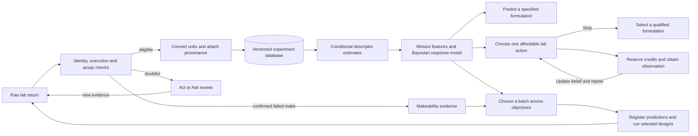

# Materials Decision Workflows

An end-to-end machine learning workflow for formulation research at a materials startup. It checks incoming lab records, builds a versioned experiment database, estimates missing material properties, and predicts the performance of a proposed formulation. A Bayesian optimiser uses those predictions, their uncertainty and the available lab budget to recommend the next experiments.

A formulation that performs poorly still supplies a training observation when it was made as intended and measured correctly. A faulty instrument reading calls for a repeat measurement. The intake gate records that distinction before a result can enter training. The public repository demonstrates the workflow with independently generated synthetic data. [Workflow and methods](docs/CAMPAIGN_WORKFLOW.md) · [Data policy](docs/DATA_POLICY.md)

**Follow a measurement that changes the next experiment.** Two synthetic lab runs start with the same candidates, evidence and five credits. In each, the planner spends one credit measuring the viscosity of an incoming binder lot. A reading of 1.94 Pa·s leads it to spend the remaining four credits making the binder-rich formulation. A reading of 5.94 Pa·s leads it to make the binder-lean formulation. Committing to a make before measuring would select binder-lean in both runs. [Paired campaign](results/shared_budget/REPORT.md) · [Decision trace](results/shared_budget/trace.json)

## From a lab return to a decision



| Decision | What the implementation produces |
|---|---|
| **Can this measurement teach us anything?** | Immutable source receipts, unit conversions, revisions and separate eligibility for performance and makeability. A valid poor response enters training. A failed meter check requests a re-read. A confirmed failed make supplies a feasibility label. |
| **When should the system ask a person?** | A shadow policy interprets standard, process and repeat residuals. It chooses a corrective action or defers. A held-out failure bank compares harmful decisions and the fraction settled against fixed rules, including under drift. |
| **What can we infer about a missing property?** | The database retains the measured value or its absence. A versioned feature view records which supplier fields were estimated through training-set correlations, their uncertainty and the observations supporting the snapshot. |
| **Is a missing property worth measuring?** | A value-of-information calculation prices the chance that an assay would change the preferred recipe. It compares the gain from a better choice with the cost of obtaining the measurement. |
| **How will this recipe perform?** | A group-weighted Bayesian response surface uses mixture interactions, process settings and uncertain descriptors to predict two performance outcomes jointly. Each estimate includes a support assessment and predictive spread. |
| **What should we make next?** | The planner starts with a space-filling design. With observations available it weighs expected Pareto-front improvement, chance of a successful make, cost and pending work. An intentional repeat can earn a batch slot. Each eligible and rejected design leaves an inspectable trace. |
| **What should we spend the next lab credit on?** | The sequential planner compares an incoming-stock assay, a new formulation, a re-read of an existing specimen, a fresh remake and stopping. Each purchase uses the same credit balance. Its return changes the evidence for the next choice. |
| **What changed after the experiment?** | The runner saves the proposal and predictions before generating any feedback, appends the new independent preparations, refits, and issues a second decision packet. The two training snapshots can be compared by hash. |

## Run the shared-budget experiment

From a checkout, run these commands with Python 3.11 or newer.

```bash
python -m pip install -e .
python -m materials_workflow shared-budget --output .local/shared-budget
```

Open `.local/shared-budget/REPORT.md` to compare the two observed paths with the fabrication-only decision under the same spend limit. The run also produces a policy specification for the persistent `session` commands, which let an operator reserve one action and submit its observed outcome before replanning. [Policy and experiment](docs/CAMPAIGN_WORKFLOW.md#choose-the-next-operation-under-one-budget)

## Batch formulation example

The bundled demo uses a fictional optical membrane to give the optimiser two competing objectives, light transmission and fracture toughness. The campaign report follows three suggested formulations from their pre-run predictions through simulated measurements and the next batch decision. [Worked campaign and figure](results/campaign/REPORT.md) · [Decision packet](results/campaign/packet.json) · [Synthetic generator](src/materials_workflow/synthetic.py)

The batch campaign and explorer use the same Python 3.11+ package.

```bash
python -m materials_workflow demo --output .local/campaign
```

Open `.local/campaign/explorer.html` in a browser to inspect a candidate, a quality decision or a prospective prediction. The explorer is a self-contained file. GitHub also renders the [campaign report](results/campaign/REPORT.md) directly.

```bash
python -m materials_workflow audit --db .local/campaign/campaign.sqlite3 --submission 2
python -m materials_workflow features --db .local/campaign/campaign.sqlite3 --out .local/features.json
python -m materials_workflow predict --db .local/campaign/campaign.sqlite3 --candidate .local/campaign/candidate.json
python -m materials_workflow measure-or-make --db .local/campaign/campaign.sqlite3 --shortlist .local/campaign/shortlist.json --cost 0.01
python -m materials_workflow recommend --db .local/campaign/campaign.sqlite3 --candidates .local/campaign/candidates.json --pending .local/campaign/pending.json --budget 7.5 --batch-size 3 --out .local/next.json
```

## Related research studies

The original research suite connects material discovery to robust process control. It includes a separate exact Gaussian-process predictor, adaptive control and decision-focused covariance learning. To reproduce its four studies, run `python -m crfml.cli all --output results`. The [study map](docs/PIPELINE.md) and reports below give the methods and outcomes.

| Study | What it demonstrates | Command | Results |
|---|---|---|---|
| Materials learning | GP prediction, conformal diagnostics, finite-pool acquisition and bounded adaptive MPC | `python -m crfml.cli run` | [Report](results/public/REPORT.md) |
| Decision-focused learning | Covariance shrinkage learned through causal Wasserstein regret control, matched likelihood baselines and distribution shifts | `python -m crfml.cli decision` | [Report](results/decision/REPORT.md) |
| Mechanism controls | Fixed-trace covariance and validation-selected radius comparisons | `python -m crfml.cli mechanism` | [Report](results/mechanism/REPORT.md) |
| Control references | Bayesian information value, adversarial identification limits and matched adaptation | `python -m crfml.cli reference` | [Report](results/reference/REPORT.md) |

Configurations are under configs/. Each study retains its inputs, per-seed outputs, numerical diagnostics, failure records and source/configuration/artifact hashes. All examples can run without an external database, credentials or confidential files.

## Mathematical and implementation details

- **Prediction and selection:** exact GP conditioning, analytic marginal-likelihood gradients, finite-sample calibration and a selection-coverage counterexample.
- **Learning through control:** analytic gradients and Hessians, implicit solution-map differentiation, fresh-solve finite-difference checks and bounded solver recovery.
- **Robust decisions:** lifted dynamics, causal feedback, a noncausal oracle, a semidefinite formulation and an independently evaluated optimal-transport adversary.
- **Diagnostic analysis:** a covariance-error/policy-performance ordering reversal, a conditional transfer bound, scale/radius equivalence and outer-optimiser stationarity checks.

The robust controller implements the formulation of [Al Taha, Yan and Bitar (2023)](https://arxiv.org/abs/2304.06783). The [methods review](research/DECISION_FOCUSED_REVIEW.md) identifies relevant decision-focused learning, covariance estimation and differentiable optimisation work, with OpenAlex records and inspected GitHub implementations. Established methods are attributed.

## Findings and limits

The benchmark illustrates why prediction error, validation decision loss and robustness are different objectives. With 28 estimation and 64 validation trajectories, the fixed-budget decision learner improves mean IID regret relative to likelihood fitting, while worsening regret under the strongest directional shift. Fixing covariance trace weakens the IID evidence. A separate convergence diagnostic reverses one seed's IID ranking despite a lower validation loss.

These results describe the declared synthetic models and optimisation budgets. The main controller uses known dynamics, perfect state observations, unconstrained inputs and a finite horizon. Its Wasserstein radius is a design parameter with no asserted statistical coverage guarantee. The separate scalar controller has its own conditional upper-state safety result.

See [findings](docs/FINDINGS.md), [transfer theory](docs/DECISION_FOCUSED_THEORY.md), [learning implementation](docs/DECISION_LEARNING.md), [optimiser diagnostics](docs/OPTIMIZER_DIAGNOSTICS.md) and [technical validation](docs/TECHNICAL_VALIDATION.md).

## Reuse and publication

The campaign package is `materials_workflow` and its console command is `materials-workflow`. The four research studies are available through `crfml`. Their source packages and study artifacts have independent provenance records.

[CONTRIBUTING.md](CONTRIBUTING.md) describes development checks and synthetic reproductions. [Reproducibility](docs/REPRODUCIBILITY.md) and [recorded verification](docs/RELEASE_VERIFICATION.md) distinguish observed checks from cross-platform claims.

To prepare a fresh publication copy:

~~~bash
python scripts/export_public.py --destination dist/public-repo
~~~

The exporter copies only reviewed paths, validates all result provenance and writes a file manifest. It excludes local inputs, caches, logs and source Git history. It refuses to overwrite a destination. Only the resulting clean directory is intended for publication.

Original code and documentation use the [MIT license](LICENSE). Public literature metadata and referenced third-party work retain their own terms.
