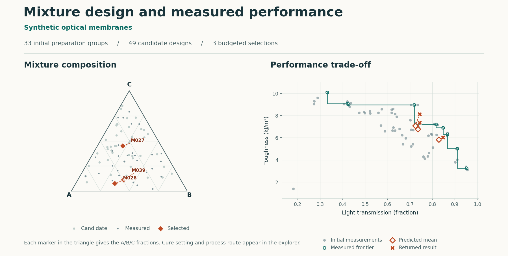

# Optical membrane campaign

This public study uses independently generated synthetic optical composites. The simulator produces preparation groups, instrument returns and partially observed material descriptors.

[Offline campaign explorer](explorer.html) · [Summary](summary.json) · [Decision packet](packet.json)

To use the explorer from GitHub, download the HTML file and open it in a browser. All evidence and figures are embedded.

## From raw returns to training data

The first intake received 72 attempts. The performance model used 61 eligible measurements from 33 preparation groups. Measurements from a shared preparation stay together during validation.

| Intake action | Initial receipts |
|---|---:|
| ask | 5 |
| feasibility only | 2 |
| remake | 2 |
| remeasure | 2 |
| use | 61 |

## Completing supplier properties

The first feature view contains 151 measured descriptor entries and 32 estimates conditioned on other known supplier properties. The database stores the estimates separately with their units, uncertainty and training-snapshot identity.

Supplier card for **M039** before the experiment.

| Property | Source | Value or estimate | Imputation SD |
|---|---|---:|---:|
| Density (g/cm³) | observed | 1.350 | 0.000 |
| Scattering (1/mm) | conditional | 0.567 | 0.117 |
| Viscosity (Pa s) | conditional | 3.114 | 0.135 |

The separate assay-pricing decision chose **make** for **M026** with each proposed assay priced at 0.010 utility units. The decision packet gives the expected gains for the alternative assays.

## Predicting both performance outcomes

The model propagates uncertainty in missing stock descriptors into both endpoint predictions. The table reports mean absolute errors from whole-preparation-group cross-validation. Predictive standard deviations describe model-based uncertainty. Coverage on new physical preparations is unverified.

| Outcome | Model MAE | Training-mean MAE |
|---|---:|---:|
| Transmission (fraction) | 0.034 | 0.156 |
| Toughness (kJ/m²) | 0.507 | 1.625 |

## Selecting experiments and learning from the returns

The first batch selected **M039, M027, M026** and spent **6.48 of 7.50** synthetic cost units. Each proposal has a record of its expected change in Pareto area, estimated probability of a successful make, distance from pending and selected designs, and cost.

| Experiment | Predicted transmission | Returned transmission | Predicted toughness (kJ/m²) | Returned toughness (kJ/m²) |
|---|---:|---:|---:|---:|
| M039 | 0.724 | 0.742 | 7.08 | 8.13 |
| M027 | 0.735 | 0.743 | 6.78 | 7.37 |
| M026 | 0.828 | 0.847 | 5.84 | 6.04 |

After simulated execution, the refit used 36 preparation groups. The next proposed batch contains **M009, M042, M047**.

## Checking decisions on doubtful returns

On 10 labelled synthetic challenge cases, the fixed gate settled 8, with 1 wrongly admitted and 1 wrongly withheld. Each scenario was constructed. Its frequency in the challenge set does not estimate its frequency in a lab.

The shadow classifier and fixed rules also see the same evidence on independent synthetic preparations. Coverage is the share of all cases settled. Error rate is the share of settled decisions with an incorrect action. The shifted generator challenges transfer.

| Evidence | Policy | Settled / total | Incorrect / settled |
|---|---|---:|---:|
| iid | Shadow classifier | 859 / 1500 | 31 / 859 |
| iid | Fixed rules | 955 / 1500 | 83 / 955 |
| shifted | Shadow classifier | 678 / 1500 | 196 / 678 |
| shifted | Fixed rules | 796 / 1500 | 283 / 796 |

Inputs, score components, training snapshots and gate evaluations are available in the decision packet. The results describe this simulator and candidate library.
