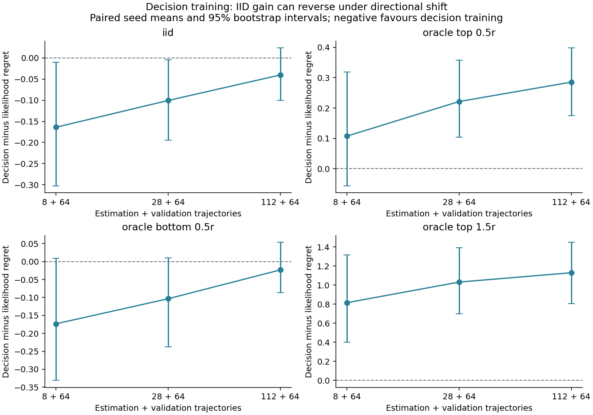
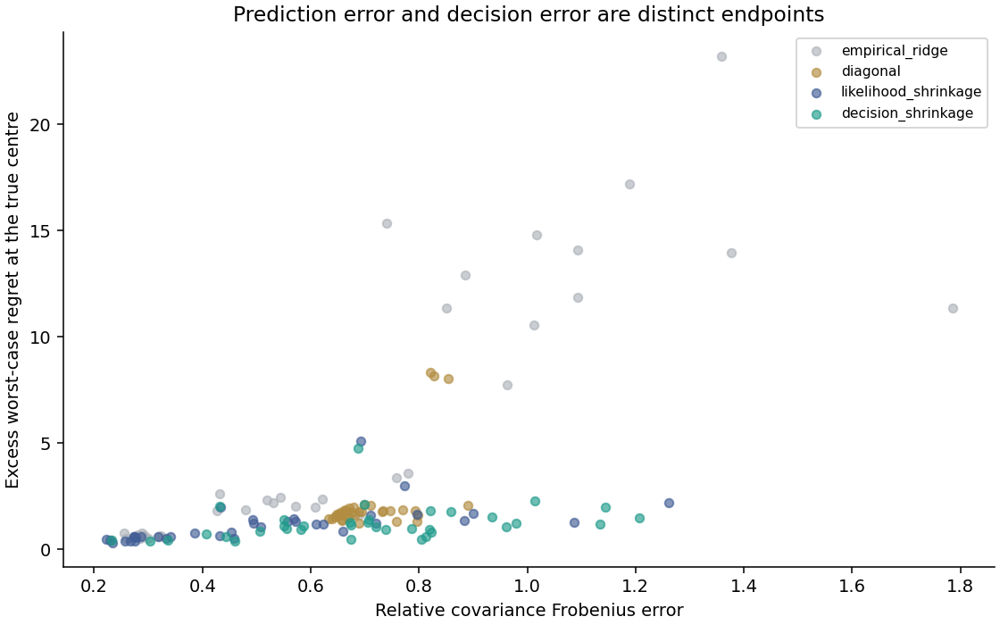

# Decision-focused covariance learning for regret control

This is the v2 main study. It uses known coupled two-state dynamics for the selected synthetic material, a six-step causal controller, and fourteen-dimensional augmented disturbance trajectories. Each trajectory includes a nondegenerate random initial state. All public observations are independently invented simulation.

Fixed design: 12 independent estimation replicates; estimation sample sizes [8, 28, 112]; **64 additional validation trajectories for every estimator**; 4096 independent evaluation paths per common shifted law. Estimation budgets are not total-data budgets.

Completed decision fits: 36/36. Raised numerical fitting failures: 0. Outer optimiser convergence flags: 10/36 within the fixed 12-iteration budget. Returned fits that exhausted the outer budget are retained and identified in fits.json.

## Frozen primary comparison

Decision-trained minus likelihood-trained expected regret, using the same covariance family, validation data and Wasserstein regret-control objective. Negative favours decision training. Expectations are evaluated analytically under the known benchmark law and checked by causal Monte Carlo rollouts. Complete-case means are conditional on successful numerical fits; denominators and failures are explicit. Intervals resample independent seeds, not timepoints. No multiplicity-adjusted discovery claim is made.

| Estimation / shift | Paired seeds | Mean difference | Bootstrap 95% interval |
|---|---:|---:|---|
| n=8/iid | 12/12 | -0.16390 | [-0.30280, -0.01033] |
| n=8/oracle_top_0.5r | 12/12 | 0.10728 | [-0.05717, 0.31878] |
| n=8/oracle_bottom_0.5r | 12/12 | -0.17333 | [-0.33126, 0.00848] |
| n=8/oracle_top_1.5r | 12/12 | 0.81630 | [0.40094, 1.31803] |
| n=28/iid | 12/12 | -0.10054 | [-0.19462, -0.00416] |
| n=28/oracle_top_0.5r | 12/12 | 0.22136 | [0.10419, 0.35767] |
| n=28/oracle_bottom_0.5r | 12/12 | -0.10356 | [-0.23761, 0.01049] |
| n=28/oracle_top_1.5r | 12/12 | 1.03229 | [0.69758, 1.39414] |
| n=112/iid | 12/12 | -0.04022 | [-0.10057, 0.02384] |
| n=112/oracle_top_0.5r | 12/12 | 0.28528 | [0.17521, 0.39829] |
| n=112/oracle_bottom_0.5r | 12/12 | -0.02338 | [-0.08652, 0.05329] |
| n=112/oracle_top_1.5r | 12/12 | 1.13014 | [0.80489, 1.44846] |

The shift names refer to distance from the true/oracle centre. They do **not** assert membership in every estimated-centre ball. Each record includes its actual Gaussian Wasserstein distance and membership test.

## IID estimator and controller comparisons

| Estimation samples | Estimator | Controller | Expected regret | Expected cost | Covariance error | True IID law inside estimated ball |
|---:|---|---|---:|---:|---:|---:|
| 8 | empirical_ridge | nominal | 57.0410 | 122.2165 | 1.1140 | 0.000 |
| 8 | empirical_ridge | dr_cost | 32.6114 | 97.7869 | 1.1140 | 0.000 |
| 8 | empirical_ridge | dr_regret | 20.8041 | 85.9797 | 1.1140 | 0.000 |
| 8 | diagonal | nominal | 17.5484 | 82.7240 | 0.7715 | 0.000 |
| 8 | diagonal | dr_cost | 15.7200 | 80.8955 | 0.7715 | 0.000 |
| 8 | diagonal | dr_regret | 15.9739 | 81.1495 | 0.7715 | 0.000 |
| 8 | likelihood_shrinkage | nominal | 16.6537 | 81.8293 | 0.8070 | 0.000 |
| 8 | likelihood_shrinkage | dr_cost | 16.2603 | 81.4358 | 0.8070 | 0.000 |
| 8 | likelihood_shrinkage | dr_regret | 15.7484 | 80.9239 | 0.8070 | 0.000 |
| 8 | decision_shrinkage | nominal | 16.7098 | 81.8854 | 0.8458 | 0.000 |
| 8 | decision_shrinkage | dr_cost | 15.6930 | 80.8685 | 0.8458 | 0.000 |
| 8 | decision_shrinkage | dr_regret | 15.5845 | 80.7600 | 0.8458 | 0.000 |
| 8 | oracle | nominal | 14.8136 | 79.9892 | 0.0000 | 1.000 |
| 8 | oracle | dr_cost | 15.3786 | 80.5542 | 0.0000 | 1.000 |
| 8 | oracle | dr_regret | 15.0325 | 80.2080 | 0.0000 | 1.000 |
| 28 | empirical_ridge | nominal | 18.2088 | 83.3844 | 0.5802 | 0.000 |
| 28 | empirical_ridge | dr_cost | 17.8351 | 83.0107 | 0.5802 | 0.000 |
| 28 | empirical_ridge | dr_regret | 16.1663 | 81.3419 | 0.5802 | 0.000 |
| 28 | diagonal | nominal | 17.5484 | 82.7240 | 0.6895 | 0.000 |
| 28 | diagonal | dr_cost | 15.6606 | 80.8362 | 0.6895 | 0.000 |
| 28 | diagonal | dr_regret | 15.9704 | 81.1460 | 0.6895 | 0.000 |
| 28 | likelihood_shrinkage | nominal | 15.9269 | 81.1025 | 0.4778 | 0.167 |
| 28 | likelihood_shrinkage | dr_cost | 16.1013 | 81.2768 | 0.4778 | 0.167 |
| 28 | likelihood_shrinkage | dr_regret | 15.4874 | 80.6630 | 0.4778 | 0.167 |
| 28 | decision_shrinkage | nominal | 15.9025 | 81.0780 | 0.7135 | 0.000 |
| 28 | decision_shrinkage | dr_cost | 15.3981 | 80.5737 | 0.7135 | 0.000 |
| 28 | decision_shrinkage | dr_regret | 15.3869 | 80.5624 | 0.7135 | 0.000 |
| 28 | oracle | nominal | 14.8136 | 79.9892 | 0.0000 | 1.000 |
| 28 | oracle | dr_cost | 15.3786 | 80.5542 | 0.0000 | 1.000 |
| 28 | oracle | dr_regret | 15.0325 | 80.2080 | 0.0000 | 1.000 |
| 112 | empirical_ridge | nominal | 15.6220 | 80.7975 | 0.2836 | 1.000 |
| 112 | empirical_ridge | dr_cost | 16.0666 | 81.2421 | 0.2836 | 1.000 |
| 112 | empirical_ridge | dr_regret | 15.2738 | 80.4494 | 0.2836 | 1.000 |
| 112 | diagonal | nominal | 17.5484 | 82.7240 | 0.6661 | 0.000 |
| 112 | diagonal | dr_cost | 15.6352 | 80.8107 | 0.6661 | 0.000 |
| 112 | diagonal | dr_regret | 15.9711 | 81.1467 | 0.6661 | 0.000 |
| 112 | likelihood_shrinkage | nominal | 15.4008 | 80.5763 | 0.2705 | 1.000 |
| 112 | likelihood_shrinkage | dr_cost | 15.8109 | 80.9864 | 0.2705 | 1.000 |
| 112 | likelihood_shrinkage | dr_regret | 15.1946 | 80.3702 | 0.2705 | 1.000 |
| 112 | decision_shrinkage | nominal | 15.4604 | 80.6359 | 0.5511 | 0.333 |
| 112 | decision_shrinkage | dr_cost | 15.2362 | 80.4117 | 0.5511 | 0.333 |
| 112 | decision_shrinkage | dr_regret | 15.1544 | 80.3300 | 0.5511 | 0.333 |
| 112 | oracle | nominal | 14.8136 | 79.9892 | 0.0000 | 1.000 |
| 112 | oracle | dr_cost | 15.3786 | 80.5542 | 0.0000 | 1.000 |
| 112 | oracle | dr_regret | 15.0325 | 80.2080 | 0.0000 | 1.000 |

## Numerical evidence

Largest independently re-solved hypergradient absolute error: 1.19e-06. Largest relative primal LMI violation: 1.51e-08. Largest fixed-policy objective recomputation gap: 3.27e-07.

Completed decision fits used 755 controller requests and 755 conic solver attempts, including independent gradient checks. A rejected Clarabel attempt permits one SCS attempt with unchanged acceptance thresholds; both attempts remain in the logs. Outer iteration limits are not convergence certificates.

These are numerical checks. The fixed-policy transport primal/dual equality does not itself certify the controller minimisation, and stationarity is not a rigorous global suboptimality bound. Synthesis separately records/gates conic primal feasibility, dual feasibility, stationarity and complementarity. The transfer theorem states its global objective-gap premise explicitly.

## Analytic policy-ordering reversal

For the one-step system with A=B=terminal Q=R=1, true second moment I and radius 0.3, the larger diagonal estimation error preserves the true optimal controller. A smaller correlation error shifts the controller and creates strictly positive transferred regret. The rank-one closed form and independent scalar minimiser agree with SDP synthesis.

| Estimator error direction | Frobenius error | True robust regret excess | Scalar/SDP action difference |
|---|---:|---:|---:|
| larger_diagonal_error | 0.40000 | -0.0000000 | 5.4e-09 |
| smaller_correlation_error | 0.14142 | 0.0050086 | 3.53e-05 |

This is a proved counterexample for the stated reference problem, not a universal ranking of estimators.

## Scale versus correlation: supplementary analysis

Moment scale and ambiguity radius interact: W(K;cM,r)=c W(K;M,r/sqrt(c)). The primary two-parameter estimator changes both scale and shape. Improved ordinary validation regret could therefore reflect reduced conservatism rather than better correlation estimation. Fitted alpha, beta, trace and covariance errors are retained. The separately declared fixed-trace/radius-tuning study addresses this mechanism; it does not replace the primary endpoint.

| Estimation samples | Fit objective | Mean alpha | Mean beta | Mean fitted / training trace |
|---:|---|---:|---:|---:|
| 8 | Likelihood | 0.4314 | 0.2809 | 1.2809 |
| 8 | Decision | 0.7725 | 0.3465 | 1.3465 |
| 28 | Likelihood | 0.2434 | 0.1104 | 1.1104 |
| 28 | Decision | 0.5746 | 0.4435 | 1.4435 |
| 112 | Likelihood | 0.0703 | 0.0385 | 1.0385 |
| 112 | Decision | 0.3821 | 0.4411 | 1.4411 |

## Same-moment negative control

Gaussian and Student nominal laws with the same second moment yield the same exact quadratic robust objective and controller. Their sample loss tails can differ. This verifies why density-model complexity alone cannot improve this particular objective.

Exact adversarial expected regret for both laws: 32.58409; exact squared transport cost: 0.87500.

| Law | Sample mean adversarial regret | MC standard error | 99th percentile |
|---|---:|---:|---:|
| gaussian | 32.75399 | 0.12384 | 154.09629 |
| student | 32.41466 | 0.20373 | 229.41888 |

## Limits

Known dynamics, perfect state observations, unconstrained signed deviation inputs, Gaussian fitted nominal laws, finite horizon, and a selected low-dimensional covariance family define the study. Radius is a design parameter, not an asserted confidence guarantee. Learned dynamics would produce policy-dependent residuals and require a separate analysis. Wasserstein expected-regret robustness is not a hard state-safety guarantee.

