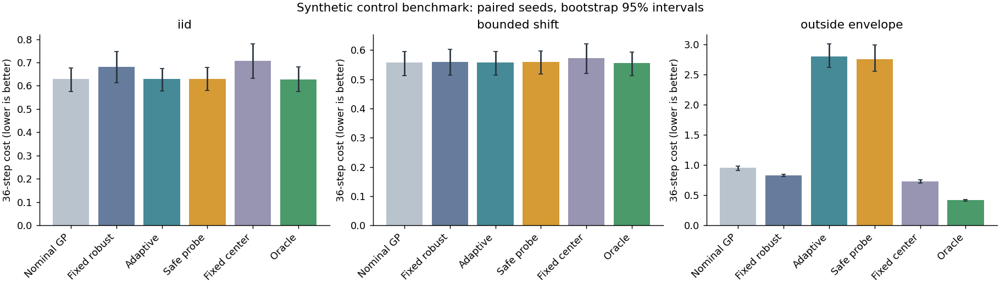
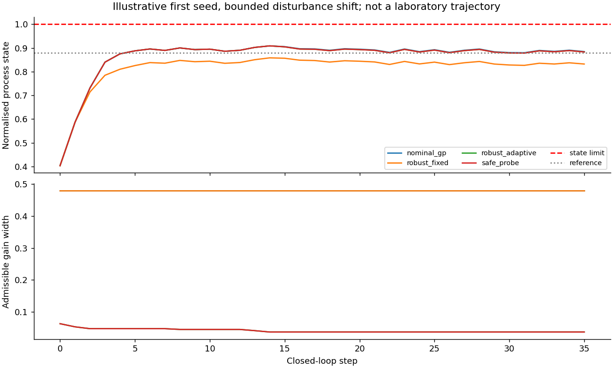

# Reproduced synthetic study

All results below use invented public simulation only. Confidence intervals resample independent paired seeds, not time steps. Small seed counts and multiple comparisons limit inference.

## Prediction and calibration

| Distribution | Model | RMSE | Coverage |
|---|---|---:|---:|
| iid | gp | 0.0670 | 0.918 |
| iid | ridge | 0.1205 | n/a |
| iid | constant | 0.1845 | n/a |
| shift | gp | 0.1808 | 0.897 |
| shift | ridge | 0.1207 | n/a |
| shift | constant | 0.3046 | n/a |

## Discovery

| Policy | Best queried feasible quality regret | Post-initial violations (12 queries) | Total violations (22 observations) | Recommendation feasible fraction | Utility regret among feasible recommendations |
|---|---:|---:|---:|---:|---:|
| random | 0.0392 | 4.25 | 7.67 | 0.917 | 0.0398 (n=11) |
| greedy | 0.0012 | 3.50 | 6.92 | 1.000 | 0.0107 (n=12) |
| constrained_ei | 0.0070 | 2.17 | 5.58 | 0.917 | 0.0119 (n=11) |

Feasibility-weighted expected improvement is a heuristic. Its sampled violations are reported, not hidden behind a safety claim.

## Control on the material chosen by constrained EI

| Scenario | Policy | Cost | Violations/trajectory | Final gain width |
|---|---|---:|---:|---:|
| iid | nominal_gp | 0.628 | 0.00 | 0.4800 |
| iid | robust_fixed | 0.682 | 0.00 | 0.4800 |
| iid | robust_adaptive | 0.628 | 0.00 | 0.0063 |
| iid | safe_probe | 0.630 | 0.00 | 0.0063 |
| iid | constant_center | 0.706 | 0.00 | 0.4800 |
| iid | oracle | 0.628 | 0.00 | 0.0000 |
| bounded_shift | nominal_gp | 0.557 | 0.00 | 0.4800 |
| bounded_shift | robust_fixed | 0.560 | 0.00 | 0.4800 |
| bounded_shift | robust_adaptive | 0.557 | 0.00 | 0.0402 |
| bounded_shift | safe_probe | 0.559 | 0.00 | 0.0402 |
| bounded_shift | constant_center | 0.574 | 0.00 | 0.4800 |
| bounded_shift | oracle | 0.556 | 0.00 | 0.0000 |
| outside_envelope | nominal_gp | 0.954 | 34.83 | 0.4800 |
| outside_envelope | robust_fixed | 0.829 | 34.42 | 0.4800 |
| outside_envelope | robust_adaptive | 2.806 | 0.00 | 0.3648 |
| outside_envelope | safe_probe | 2.758 | 0.25 | 0.3626 |
| outside_envelope | constant_center | 0.729 | 27.08 | 0.4800 |
| outside_envelope | oracle | 0.416 | 0.00 | 0.0000 |

## Predeclared primary comparison

Safe probe minus ordinary adaptive robust control: a negative cost difference favours probing. Report all scenarios and acquisition policies; no best-seed selection.

| Acquisition/scenario | Paired mean difference | Bootstrap 95% interval |
|---|---:|---|
| random/iid | 0.0020 | [-0.0000, 0.0058] |
| random/bounded_shift | 0.0021 | [0.0000, 0.0053] |
| random/outside_envelope | -0.0398 | [-0.0761, -0.0091] |
| greedy/iid | 0.0018 | [-0.0000, 0.0052] |
| greedy/bounded_shift | 0.0019 | [-0.0000, 0.0054] |
| greedy/outside_envelope | -0.0362 | [-0.0852, -0.0000] |
| constrained_ei/iid | 0.0017 | [0.0000, 0.0052] |
| constrained_ei/bounded_shift | 0.0019 | [0.0000, 0.0054] |
| constrained_ei/outside_envelope | -0.0474 | [-0.1055, -0.0000] |

## Selection bias counterexample

Fixed-candidate coverage: 0.902; selected-candidate coverage: 0.078; exact selected coverage: 0.077; Bonferroni selected coverage: 0.952.

The deliberately constructed Gaussian counterexample disproves a general implication from marginal coverage to post-selection coverage. It is not a claim about empirical lab residuals.

## Limits

Only a scalar fully observed linear plant is certified, with known decay and fixed gain. The robust guarantee is conditional on the physical gain/disturbance bounds. Out-of-envelope stress intentionally breaks those assumptions. Neither Gaussian calibration nor zero observed violations proves real-world safety. No private held-out values are used.

